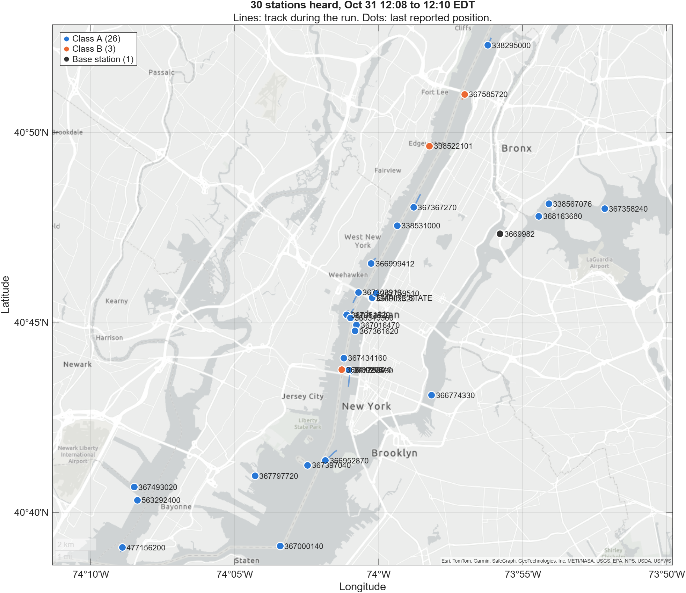
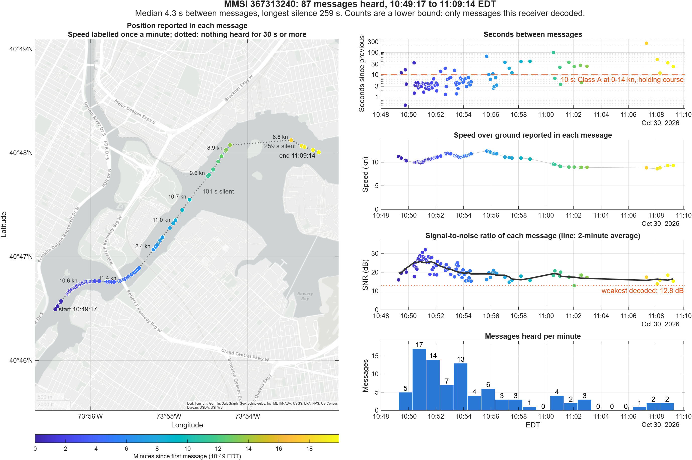

# NYC Ferry AIS Receiver (MATLAB + RTL-SDR)

Receive, decode, log and map AIS (Automatic Identification System) ship-position broadcasts in
New York Harbor with a low-cost RTL-SDR, to build our own ground truth of ferry traffic and
compare it against what public AIS websites show. Part of the Columbia University DOT Ferry
Project.



## Features

- **Full receive chain in MATLAB**: both AIS channels (161.975 / 162.025 MHz) captured at once,
  FM demodulation, HDLC/NRZI framing, CRC-16 check, and decoding of all 27 ITU-R M.1371 message
  types. No external AIS decoder needed.
- **Logging** to standard `!AIVDM` NMEA (works with OpenCPN, pyais, etc.), a JSON-lines file with
  every decoded field plus signal level and SNR, and a CSV of each station's latest state.
- **Live map** of stations while receiving, and offline maps of whole runs or single vessels.
- **Ferry watchlist** of 79 vessels (Seastreak, NYC Ferry, NY Water Taxi / Circle Line,
  NY Waterway) with live alerts and a report of which were heard, how well, and where.
- **Gain sweep** tool to pick the tuner gain that avoids front-end overload at a given site.

## Hardware

| Item | Used here |
|---|---|
| SDR | Nooelec NESDR SMArt v5 (RTL2832U + R820T, 28.8 MHz TCXO), [datasheet](docs/nesdr_smart_rtl_sdr_v5_datasheet_revision_1.pdf) |
| Antenna | 162 MHz AIS antenna, outdoors or at a window, away from laptops and chargers |
| Tuner gain | 32.8 dB (default; found with `aisGainSweep`) |

Reception range with the AIS antenna is about 24 km (Kill Van Kull to the George Washington
Bridge from Astoria).

## Requirements

- MATLAB (developed and tested on R2026a)
- Communications Toolbox
- Communications Toolbox Support Package for RTL-SDR Radio (for live reception only; recorded
  `.bb` files and NMEA logs decode without it)
- Mapping Toolbox is **not** required (maps use `geoaxes`/`geobasemap` from base MATLAB)

## Quick start

```matlab
cd C:\MATLAB-AIS-DOT
setup                                   % adds src\ and tests\ to the path

aisReceive                              % receive with a live map; close the map window to stop
aisReceive(Watchlist='data\ferry_watchlist.csv')   % same, with alerts for listed ferries
v = aisReceive(Duration=900, ShowMap=false);       % 15-minute headless run
```

Every run writes to `logs\` (file stamp is local time; times inside the jsonl are UTC):

| File | Contents |
|---|---|
| `ais_<yyyyMMdd_HHmmss>.nmea` | Raw `!AIVDM` sentences |
| `ais_<stamp>.jsonl` | One decoded message per line: time, channel, signal level, SNR, NMEA, all fields |
| `vessels_<stamp>.csv` | Latest state of each station |

A status line every 30 s shows packets and noise floor per channel. A healthy noise floor at
32.8 dB is about -52 to -56 dB; if it is ~10 dB higher and nothing decodes, move the antenna
away from electronics.

## Analysing logs

```matlab
% Every station in a run
plotAisMap('logs\ais_20261031_120822.jsonl', ExportFile='logs\map.png');

% One vessel: track, message gaps, speed, SNR, messages per minute
plotVesselTrack('logs\ais_20261030_104912.jsonl', 367313240, ExportFile='logs\track.png');

% Which watchlist ferries were heard across several runs
r = aisWatchReport('logs\ais_20261106_*.jsonl', ExportFile='logs\watch.png', CsvFile='logs\watch.csv');

% Find the best tuner gain at a new site (~8 min)
r = aisGainSweep();

% Decode NMEA from another receiver or website
msg = aisDecodeMessage(aisNmeaToBits({'!AIVDM,1,1,,B,177KQJ5000G?tO`K>RA1wUbN0TKH,0*5C'}));
```



Ship names arrive only in Type 5/24 messages, sent every 6 minutes, so run at least 15 minutes
when you need names (e.g. for the watchlist report).

## Repository layout

```
.
├── setup.m                 Add src\ and tests\ to the MATLAB path
├── src\
│   ├── aisReceive.m        Receive from the RTL-SDR (or a .bb file), decode, log, live map
│   ├── aisDetectPackets.m  HDLC frame detection: NRZI, bit unstuffing, CRC-16
│   ├── aisDecodeMessage.m  Decode all 27 ITU-R M.1371 message types to a struct
│   ├── aisNmeaToBits.m     !AIVDM sentences -> bits (checksum verified)
│   ├── aisToNmea.m         Bits -> !AIVDM sentences
│   ├── aisNamesMatch.m     Compare ship names allowing AIS abbreviations / truncation
│   ├── aisWatchReport.m    Watchlist report across logs
│   ├── aisGainSweep.m      Tuner-gain sweep
│   ├── plotAisMap.m        Map of every station in a run
│   └── plotVesselTrack.m   Five-panel view of one vessel over time
├── tests\testAis.m         Unit and end-to-end tests
├── data\ferry_watchlist.csv  Ferry operators, names, MMSIs and confidence status
├── docs\                   Radio datasheet and README images
└── logs\                   Recordings and exported figures
```

## Ferry watchlist

`data\ferry_watchlist.csv` has columns `Operator, Name, MMSI, Status`. `Status` is:

| Status | Meaning |
|---|---|
| `seen` | Already heard in our own recordings |
| `confident` | MMSI from public sites, not yet heard by us |
| `candidate` | MMSI is doubtful |
| `none` | No MMSI known (`NaN`); resolved by matching broadcast names |

## Tests

```matlab
setup
runtests('testAis')
```

Covers position and static/voyage decoding against gpsd reference sentences, the NMEA round
trip, a synthetic two-channel capture through `aisReceive`, and (if the MathWorks
`ShipTrackingUsingAISSignalsExample` is downloaded) a real over-the-air capture. Run after
changing any decoder file.

## Interpreting results

- Message counts are a lower bound: only what this receiver decoded. Gaps while a vessel's
  position keeps advancing are reception gaps, not the ship going silent.
- Class A reporting interval: 10 s at 0-14 kn, 6 s at 14-23 kn, 2 s above 23 kn, 3.3 s while
  turning.
- Trust position, speed and course; status, ETA and destination are often stale.
- The shore base station MMSI 003669982 (Astoria / Hell Gate) transmits every 20 s on both
  channels and is a handy SNR reference, but its reported date is wrong (GPS week rollover).

More operating notes and reference results are in [CLAUDE.md](CLAUDE.md).
